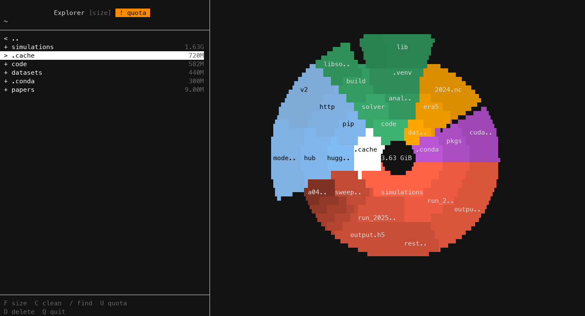

# bonsai-romeo

See what takes up **your** space on the [ROMEO](https://romeo.univ-reims.fr/) cluster (home, scratch, projects), check your quotas and clean up, from the terminal. A fork of [bonsai](https://github.com/orrnithogalum/bonsai) for ROMEO users.



## Install

On a ROMEO login node:

```bash
git clone https://github.com/wolf75222/bonsai-romeo.git ~/bonsai-romeo && ~/bonsai-romeo/install.sh
```

Then run `bonsai-romeo`. To update: `cd ~/bonsai-romeo && git pull && ./install.sh`.

## Use

```bash
bonsai-romeo                   # your spaces: home, scratch, projects
bonsai-romeo /project/<group>  # one folder
bonsai-romeo --quota           # your quotas
bonsai-romeo --cleanup         # what could be cleaned
bonsai-romeo --summary         # size and file count of each space
bonsai-romeo --quota --json    # the same as JSON (also --summary, --cleanup)
```

| Key | |
|---|---|
| `ENTER` / `⌫` | open / go up (`l` / `h` too) |
| `F` | size, size on disk, number of files |
| `S` / `A` | order: size, name, oldest first / age column |
| `/` | search folders |
| `C` | cleanup suggestions |
| `U` | quotas, then `1`-`9` to open a space |
| `W` | what grew since the previous scan |
| `R` | scan the folder again |
| `SPACE` / `*` / `D` | mark / mark all / delete, with a progress bar |
| `T` | pack a folder into one `.tar` (file quota) |
| `Y` | copy the path |
| `?` | every key |

## What it does

- Shows only your data: your spaces and your files. Other members' files in a project stay hidden.
- Shows your GPFS quotas, for space and number of files.
- Suggests what to clean: caches, build folders, old data, folders of many files, core dumps, largest files.
- Packs a folder into one `.tar` when the file quota is the problem, and shows what grew since last time.
- Searches all your folders by name.
- Starts at once from the previous scan, and counts like the quotas do (hard links once).
- Works in any terminal, over SSH too: 24-bit colors, round chart, aligned columns.

> [!WARNING]
> ROMEO has no backups: what you delete is gone for good.

## Docs

[Usage](docs/usage.md) · [Quotas on ROMEO](docs/quotas.md) · [Configuration](docs/configuration.md) · [Terminals](docs/terminals.md) · [Changes from bonsai](docs/changes.md)

GPL-3.0, like [bonsai](https://github.com/orrnithogalum/bonsai).
