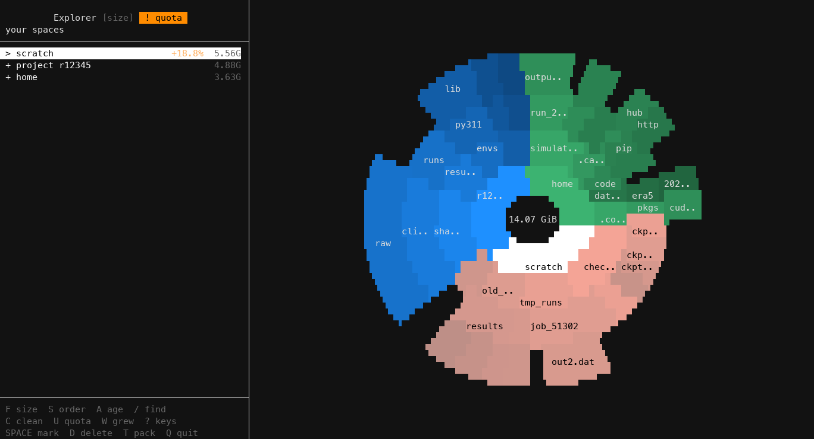
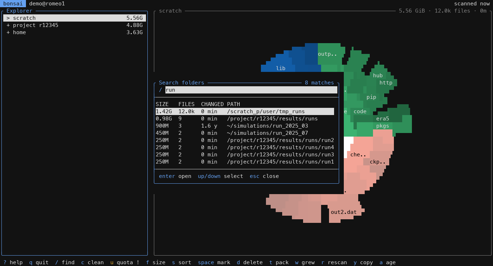
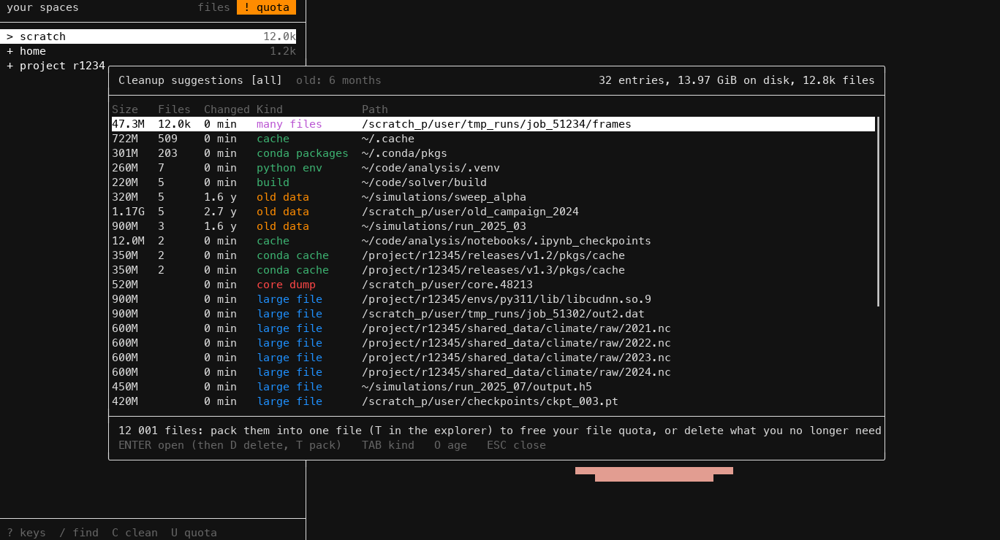
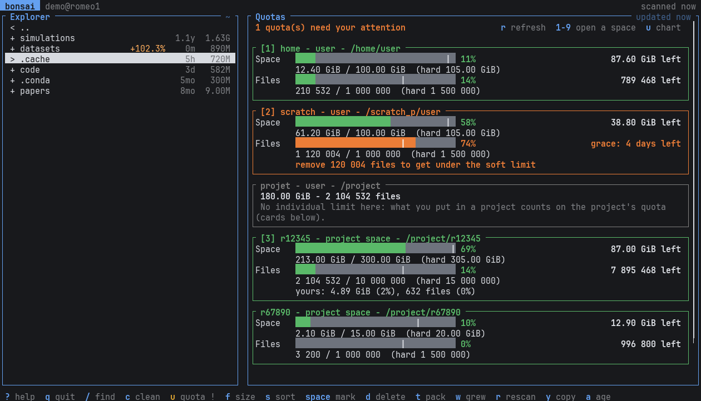
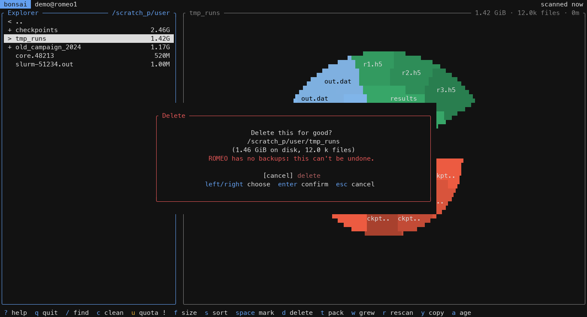

# Usage

## Explorer

bonsai-romeo starts on **your spaces**: home, scratch, and one entry per project you belong to. `ENTER` opens a folder. `⌫` or `ESC` goes back up, and from a space straight back to the list of spaces. The title shows where you are.

- Sizes marked `~` aren't final yet: they come from the previous scan while this one runs. A folder switches to its new size once it is scanned.
- `+1.2%` / `-0.5%` is the change since the previous scan.
- `F` cycles through size, size on disk (what the space quota counts) and number of files (what the file quota counts). Use the file count to find what fills your file quota.
- In the chart, the selected folder is white and its sub-folders are paler. There are 2 rings while scanning, then up to 4.

## Search: `/`

Finds folders by name in all your spaces as you type, biggest first. Every word must be in the path, the last one in the folder name: `adc build` finds the build folders under a path containing `adc`. `UP`/`DOWN` select, `ENTER` opens the folder in the explorer, `ESC` closes. It finds folders only, since files aren't kept in memory.

## Cleanup: `C`

Lists what could be cleaned, biggest first, with what each entry is and how to clean it:

- caches and folders that get rebuilt (pip, huggingface, conda, spack and apptainer caches, `__pycache__`, `node_modules`, build folders, virtual envs...),
- folders of 1 GiB or more where nothing changed for 6 months (`CLEANUP_OLD_DAYS`),
- core dumps and your largest files.

`TAB` shows one kind at a time. `ENTER` opens the entry in the explorer, where `D` deletes it. The same list prints with `bonsai-romeo --cleanup`.

## Quotas: `U`

Shows your quotas for space and number of files: how much is left, and the grace period when a soft limit is exceeded. `R` refreshes them. The same view prints with `bonsai-romeo --quota`. See [Quotas on ROMEO](quotas.md).

## Deleting: `D`

`D` (or `fn` + `⌫`, which sends `SUPPR`) asks first, showing the path, size and file count. The dialog starts on **cancel**: `RIGHT` then `ENTER` deletes. It only deletes your own files inside your spaces, never a whole space. Big folders are deleted in the background, and deleting works while the scan runs.

A folder is checked before anything is deleted. If something in it can't be deleted (someone else's folder, a read-only parent), nothing is deleted and the message says what blocks. Your own read-only folders inside it are made writable first, and the message says so.

> ROMEO has no backups: what you delete is gone for good.

## Command line

| Command | |
|---|---|
| `bonsai-romeo [path]` | explore your spaces, or one folder |
| `--quota` | print your quotas and exit |
| `--cleanup` | scan, print the cleanup suggestions and exit |
| `--summary` | scan, print the size, size on disk and file count of each space |
| `--help` | options and keys |
