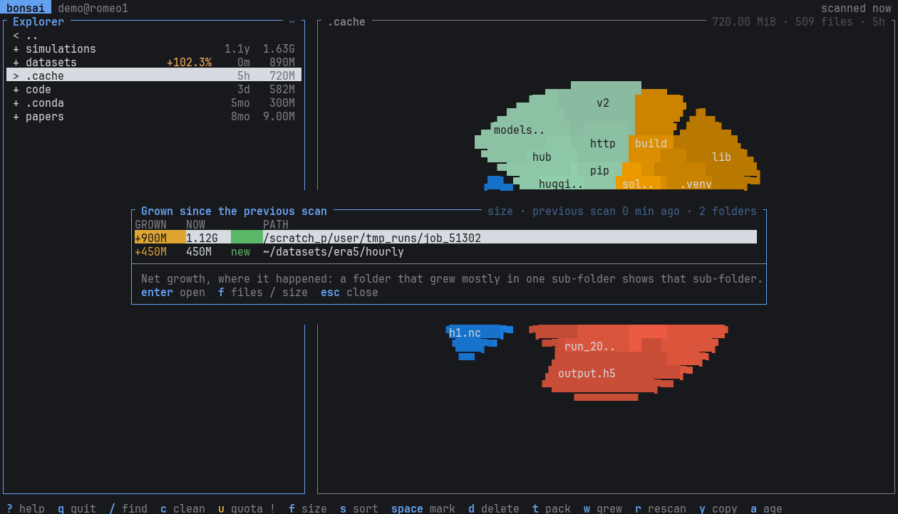
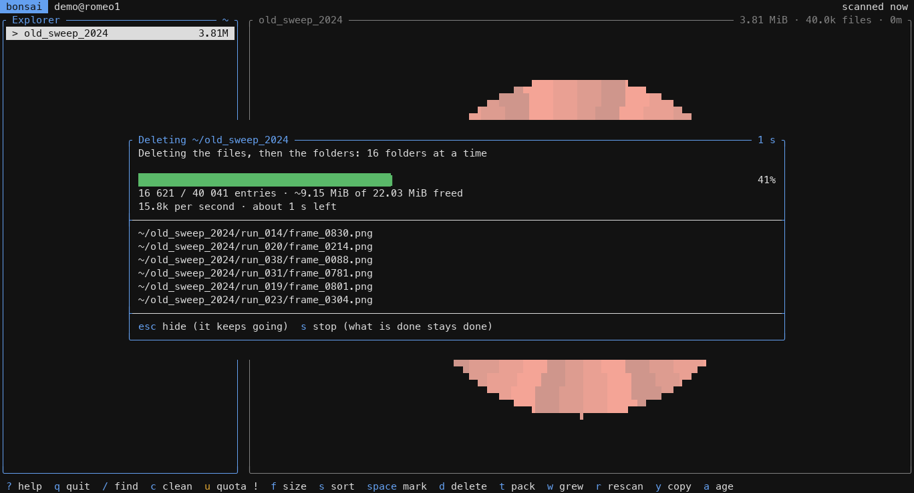

# Usage

## Explorer

bonsai-romeo starts on **your spaces**: home, scratch, and one entry per project you belong to. `ENTER` opens a folder. `⌫` or `ESC` goes back up, and from a space straight back to the list of spaces. The path shows in the frame of the Explorer panel; the right panel is titled with the selected entry, its size, files and last change.

- Sizes marked `~` aren't final yet: they come from the previous scan while this one runs. A folder switches to its new size once it is scanned.
- `?`: a folder of yours the scan doesn't know, not reached yet or made after the scan. `R` scans the folder shown again and gives it its size.
- `!`: a folder in it couldn't be read (see [Unreadable folders](#unreadable-folders-)), so the size may be too low.
- `+1.2%` / `-0.5%` is the change since the previous scan.
- `F` cycles through size, size on disk (what the space quota counts) and number of files (what the file quota counts). Use the file count to find what fills your file quota.
- `S` orders by size (of what `F` shows), by name, or oldest change first. `A` shows how long ago each entry last changed.
- `R` scans the folder shown again, after changes made elsewhere (a job, another terminal). From your spaces, it scans them all again.
- `Y` copies the path of the selected entry, for a shell. It goes through your terminal (OSC 52), over SSH too: iTerm2, Ghostty, WezTerm, kitty and most others do it; in tmux, `set -g set-clipboard on`.
- `j` / `k`, `g` / `G`, `l` / `h` move like in vim. `?` lists every key.
- In the chart, the selected folder is white and its sub-folders are paler. There are 2 rings while scanning, then up to 4.

## Search: `/`

Finds folders by name in all your spaces as you type, biggest first. Every word must be in the path, the last one in the folder name: `adc build` finds the build folders under a path containing `adc`. `UP`/`DOWN` select, `ENTER` opens the folder in the explorer, `ESC` closes. It finds folders only, since files aren't kept in memory.

## Cleanup: `C`

Lists what could be cleaned, biggest first, with what each entry is and how to clean it:

- caches and folders that get rebuilt (pip, huggingface, conda, spack and apptainer caches, `__pycache__`, `node_modules`, build folders, virtual envs...),
- old data: folders of 100 MiB or 10,000 files or more where nothing changed for 6 months, and the biggest files unchanged as long (`O` switches between 3 months, 6 months, 1 year and 2 years; the default is `CLEANUP_OLD_DAYS`),
- folders of 10,000 files or more, for the file quota: each where its files are, not every folder above it,
- core dumps and your largest files.

`TAB` shows one kind at a time (all, caches and builds, old data, many files, files). `ENTER` opens the entry in the explorer, where `D` deletes it and `T` packs it. The list is sorted by size on disk, or by files when the explorer shows files (`F`). The same list prints with `bonsai-romeo --cleanup`.

## What grew: `W`

Lists the folders that grew the most since the previous scan, for what the explorer shows (`F`: size or files). Each growth shows where it happened: a folder that grew mostly in one sub-folder shows that sub-folder. It needs a previous scan, so it lists nothing the first time.

## Packing a folder: `T`

When the file quota is full, the files have to go, not the space: `T` packs the selected folder into one `.tar` next to it, and thousands of files become one.

1. `tar` writes `name.tar.part` (no compression: it stays fast and light on the login node).
2. The archive is read back: it must list every entry of the folder.
3. Only then is it renamed to `name.tar` and the folder deleted, with the same checks as `D`.

If anything goes wrong (a file tar can't read, the quota full, the folder changing meanwhile), the `.part` is removed and nothing is deleted. Quitting stops it the same way. To get the folder back: `tar -xf name.tar`.

## Quotas: `U`

Shows your quotas for space and number of files: how much is left, the grace period when a soft limit is exceeded, and how much to remove to get back under it. In a project, it says how much of it is yours. `R` refreshes them.

The cards of your spaces are numbered: `1` to `9` opens that space in the explorer, sorted by files when the file quota is the fuller one, by size on disk otherwise. The same view prints with `bonsai-romeo --quota`. See [Quotas on ROMEO](quotas.md).

## Deleting: `D`

`D` (or `fn` + `⌫`, which sends `SUPPR`) asks first, showing the path, size and file count. The dialog starts on **cancel**: `RIGHT` then `ENTER` deletes. It only deletes your own files inside your spaces, never a whole space. Big folders are deleted in the background, and deleting works while the scan runs.

`SPACE` marks the selected entry (in any folder) and moves to the next one, `*` marks every entry of the folder shown: `D` then deletes every marked entry at once, after one dialog with their total. While entries are marked, the keys line says how many and what they hold. `X` clears the marks.

A folder is deleted on 16 threads, one folder each: GPFS takes a moment per file, and one at a time a million files took more than twenty minutes. On ROMEO, 100,000 files go in about 6 seconds (`rm -rf`: about 15).

While it runs, a window shows a bar, how many entries are gone, the space freed, how fast, about how long is left, and the files being deleted. `ESC` hides it (a line at the bottom says how far it got, `P` shows the window again), `S` stops: what is deleted stays deleted, the rest stays, and the folder is scanned again so its size is right. Packing (`T`) and scanning again (`R`) show the same window.

The totals stay exact: a deleted file that changed after the scan started may have been counted with another size, so its folder is scanned again.

A folder is checked before anything is deleted. If something in it can't be deleted (someone else's folder, a read-only parent), nothing is deleted and the message says what blocks. Your own read-only folders inside it are made writable first, and the message says so.

> ROMEO has no backups: what you delete is gone for good.

## Unreadable folders: `!`

A folder the scan couldn't read completely (a folder of yours without read permission, an I/O error or a stale handle on GPFS) isn't counted, so the sizes above it are too low. They are marked `!`, a line under the list says how many there are, and `!` lists them with what to do. `--summary` and `--cleanup` print them too.

## Command line

| Command | |
|---|---|
| `bonsai-romeo [path]` | explore your spaces, or one folder |
| `--quota` | print your quotas and exit |
| `--cleanup` | scan, print the cleanup suggestions and exit |
| `--summary` | scan, print the size, size on disk and file count of each space |
| `--json` | with `--quota`, `--cleanup` or `--summary`: the same as JSON, for scripts |
| `--help` | options and keys |
